# Modernización de un catálogo legacy con búsqueda semántica

**Autor:** Daniel Cobos Ramírez  
**Certificación:** DP-800  

## Objetivo

Modernizar un catálogo relacional de 30 productos ficticios de informática
y accesorios, incorporando embeddings y búsqueda semántica en SQL Server 2025.

El proyecto se ejecuta en local mediante SQL Server, Ollama y PowerShell.
Las consultas se ejecutan desde Visual Studio Code con la extensión SQL Server.

## Entorno

| Componente | Configuración |
|---|---|
| Motor de base de datos | SQL Server 2025 |
| Versión principal | 17 |
| Edición | Enterprise Evaluation Edition (64-bit) |
| Herramienta de consultas | Visual Studio Code con la extensión SQL Server (mssql) |
| Modelo de embeddings | embeddinggemma:300m mediante Ollama |
| Dimensiones | 768 |
| Memoria RAM del equipo | 16 GB |
| Conexión SQL | localhost, autenticación integrada de Windows |

## Alcance y estado final

Se han migrado 30 productos de seis categorías a un modelo con tablas
relacionadas y se han almacenado sus 30 embeddings de 768 dimensiones.
La solución incorpora búsqueda semántica y textual, una vista, una consulta
avanzada, un índice relacional y pruebas de seguridad por roles.

Se conservan dos pruebas iniciales y se comparan dos casos adicionales
(casos 3 y 4). Las métricas finales se calculan únicamente sobre esos
dos casos adicionales. No se incluye una aplicación ni generación de
respuestas con un modelo de chat (RAG).

El enunciado original del profesor no está disponible para esta revisión.
Por ello, este documento describe el alcance implementado y las evidencias
registradas, sin certificar el cumplimiento íntegro de una rúbrica externa.

## Arquitectura

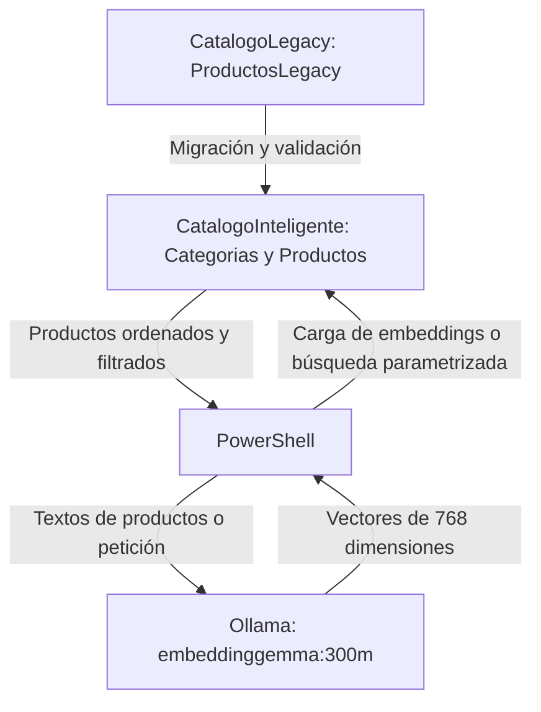

Ollama genera los vectores. SQL Server almacena los datos, aplica los
filtros explícitos y calcula las distancias. PowerShell coordina las llamadas.
La búsqueda textual y el análisis relacional pueden ejecutarse directamente
en SQL Server sin Ollama.

## Cómo retomar el proyecto

Con la base de datos y el modelo ya preparados:

1. Abrir Ollama desde Inicio de Windows.
2. Abrir la carpeta del proyecto en VS Code y una terminal PowerShell.
3. Comprobar que SQL Server local está iniciado.
4. Comprobar Ollama y ejecutar la búsqueda desde la raíz del proyecto:

```powershell
Invoke-RestMethod http://localhost:11434/api/tags
Set-ExecutionPolicy -Scope Process -ExecutionPolicy RemoteSigned
.\scripts\10_search_products.ps1
```

Si Ollama no responde, ejecutar `ollama serve` en otra terminal y dejarla
abierta. No es necesario iniciarlo otra vez si ya está escuchando en el puerto.
Los 30 embeddings permanecen en SQL Server: no hay que regenerarlos al abrir
una nueva sesión.

Para reproducir desde cero, seguir los pasos 1 a 14 y sus scripts en orden.
Los archivos SQL se ejecutan desde el editor conectado a la instancia local;
los `.ps1`, desde PowerShell. La conexión integrada utiliza la identidad de
Windows del ejecutor. La creación de bases de datos, índices y usuarios
requiere una cuenta con permisos suficientes para esas operaciones.

## Paso 1 — Creación de la base de datos legacy

### Objetivo

Crear `CatalogoLegacy`, que representará el catálogo original antes
de su modernización.

### Script

Archivo: [01_create_legacy_database.sql](scripts/01_create_legacy_database.sql)

### Comprobación

Consultar `sys.databases` para comprobar que la base de datos existe
y está en estado `ONLINE`.

### Resultado

Se ha ejecutado el script desde Visual Studio Code utilizando la
extensión SQL Server, conectado a la instancia local `localhost`.

La consulta de comprobación devuelve:

| Base de datos | Estado | Nivel de compatibilidad |
|---|---|---|
| CatalogoLegacy | ONLINE | 170 |

La base de datos está disponible para comenzar a crear las tablas.

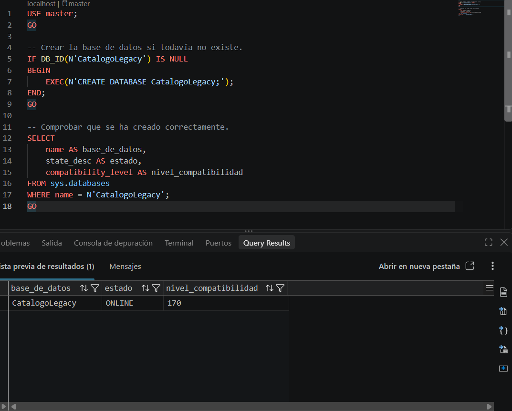

## Paso 2 — Creación de la tabla del catálogo legacy

### Objetivo

Crear `dbo.ProductosLegacy` dentro de `CatalogoLegacy` para almacenar
los productos del catálogo original.

### Script

Archivo: [02_create_legacy_table.sql](scripts/02_create_legacy_table.sql)

### Diseño

La tabla contiene seis columnas: ProductoId, Nombre, Categoria,
Descripcion, Precio y Stock.

Se utiliza una clave primaria para identificar cada producto,
campos obligatorios y restricciones CHECK para impedir precios
y existencias negativos.

La categoría se almacena como texto en cada producto. En una fase
posterior se trasladará a una tabla relacionada.

### Comprobación

El script consulta la estructura mediante INFORMATION_SCHEMA.COLUMNS
y cuenta los registros de la tabla.

### Resultado

Se ha creado la tabla `dbo.ProductosLegacy` en `CatalogoLegacy`.

La consulta de metadatos confirma las seis columnas con los tipos
y tamaños previstos. Todas están definidas como NOT NULL.

El recuento devuelve 0 productos, ya que todavía no se han cargado datos.

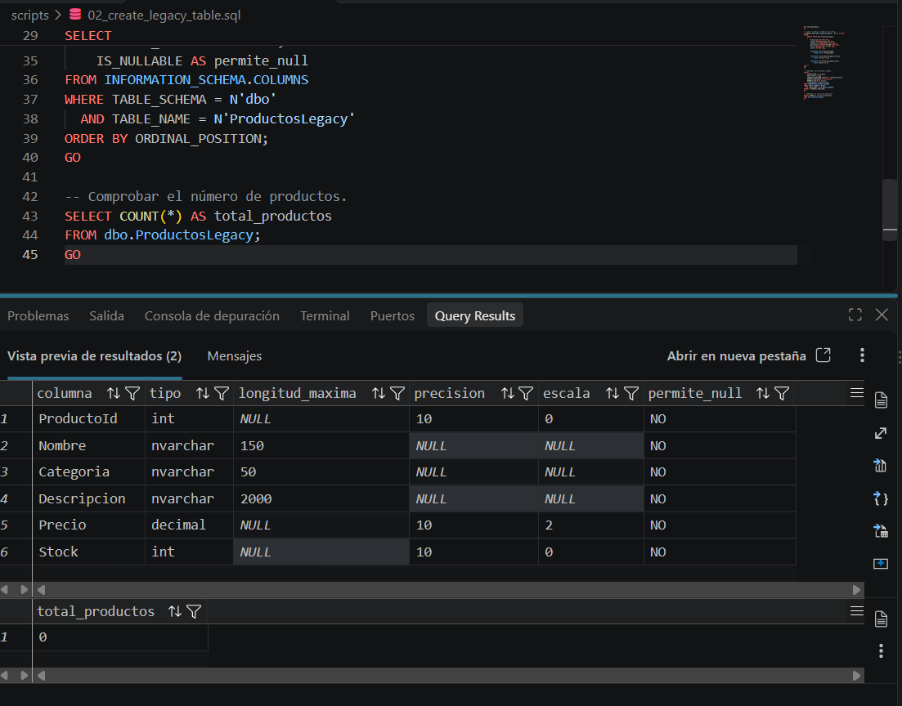

## Paso 3 — Carga del catálogo de productos

### Objetivo

Cargar 30 productos ficticios de informática y accesorios en
`dbo.ProductosLegacy`.

### Script

Archivo: [03_insert_legacy_products.sql](scripts/03_insert_legacy_products.sql)

### Datos de prueba

El catálogo contiene seis categorías con cinco productos cada una:
portátiles, monitores, teclados, ratones, almacenamiento y accesorios.

Las descripciones incluyen características y usos que permitirán
comparar búsquedas tradicionales y semánticas. Los precios son ficticios.

Se incluyen tres productos sin existencias para probar los filtros
de disponibilidad.

El script inserta únicamente los identificadores que no existen,
por lo que puede repetirse sin duplicar registros.

### Comprobación

Se consulta el total de productos, el reparto por categoría y el
catálogo completo.

### Resultado

Se han cargado 30 productos ficticios en `dbo.ProductosLegacy`.
La comprobación confirma seis categorías con cinco productos cada una.

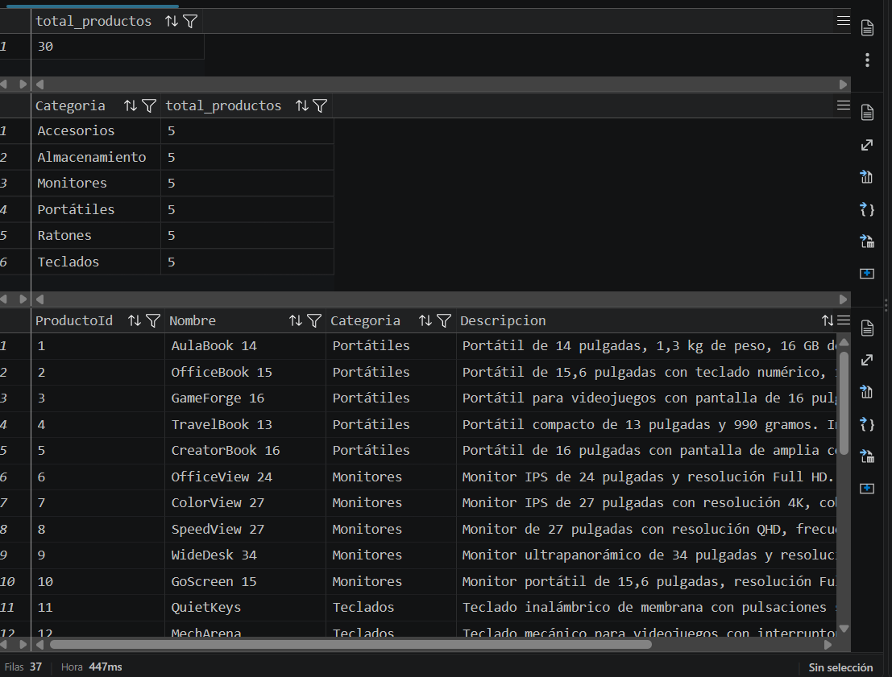

## Paso 4 — Búsquedas tradicionales

### Objetivo

Comprobar cómo funciona la búsqueda por coincidencias de texto
y establecer una referencia para evaluar la búsqueda semántica.

### Script

Archivo: [04_legacy_search.sql](scripts/04_legacy_search.sql)

### Comprobación

Se ejecutan tres consultas:

1. Teclados disponibles cuya descripción contiene «silencioso».
2. Portátiles disponibles de hasta 800 € cuya descripción contiene «estudiar».
3. Portátiles disponibles de hasta 800 €, sin filtro de texto.

La comparación permite distinguir los filtros de negocio
de la coincidencia literal de palabras.

### Resultado

La búsqueda por el patrón «silencios» devuelve QuietKeys.

La búsqueda por «estudiar» no devuelve productos, aunque AulaBook 14
y OfficeBook 15 cumplen los filtros de precio y disponibilidad.
Sus descripciones no contienen esa palabra.

### Incidencia y corrección

El patrón inicial «%silencioso%» no encontraba QuietKeys porque
su descripción contiene «silenciosas». Se sustituyó por «%silencios%»
para contemplar ambas terminaciones.

Esta prueba muestra que LIKE busca patrones textuales y no interpreta
por sí mismo el significado de una petición.

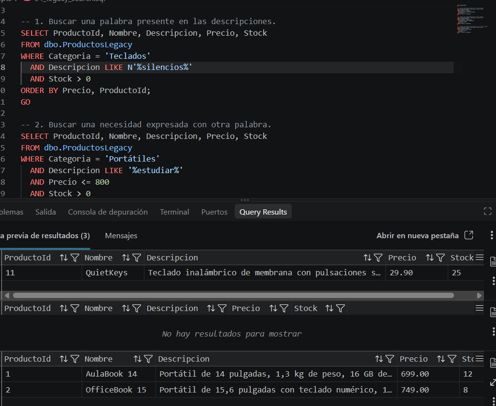

## Paso 5 — Creación del catálogo modernizado y migración

### Objetivo

Crear CatalogoInteligente y migrar el catálogo original a un modelo
con productos y categorías relacionadas.

### Script

Archivo: [05_create_and_migrate.sql](scripts/05_create_and_migrate.sql)

### Diseño

- Categorias almacena cada categoría una sola vez.
- Productos conserva los identificadores, descripciones, precios y stock.
- Una clave foránea relaciona cada producto con su categoría.
- Se mantienen restricciones para impedir precios y existencias negativos.

El stock permanece en Productos porque el alcance contempla una única
existencia por producto, sin almacenes ni movimientos de inventario.

### Migración y validación

Las inserciones se ejecutan dentro de una transacción.

Se utiliza EXCEPT en ambas direcciones para comprobar que el catálogo
reconstruido coincide con el origen en todos los campos migrados.
Si se detectan diferencias, se deshacen las inserciones.

El script permite repetir la carga sin duplicar identificadores,
pero no actualiza productos existentes.

### Resultado

La migración se ha ejecutado correctamente:

| Productos en origen | Productos en destino | Categorías |
|---|---|---|
| 30 | 30 | 6 |

La validación con EXCEPT en ambas direcciones no ha detectado
diferencias entre el catálogo original y el modernizado.

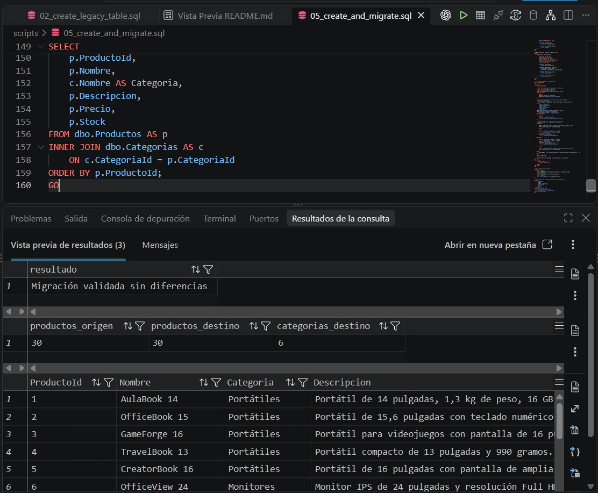

## Decisión técnica — Generación local de embeddings

Se utilizará un modelo de embeddings ejecutado localmente para que
la solución funcione sin depender de Azure ni de una suscripción activa.

Aunque durante los laboratorios se ha trabajado con el modelo
text-embedding-3-small en Azure, para este proyecto se elige una
alternativa local por los siguientes motivos:

- Mantener el alcance local acordado para el proyecto.
- Permitir reproducir el proyecto sin una cuenta de Azure.
- Evitar la necesidad de claves y endpoints de servicios en la nube.
- Mantener los textos del catálogo y las consultas en el equipo.
- Evitar costes y límites de cuota asociados a servicios de Azure.

SQL Server 2025 almacenará los datos relacionales y los vectores.
El modelo local generará los embeddings de los productos y de las
peticiones de búsqueda.

La instalación inicial requerirá descargar las herramientas y el modelo.
Una vez configurado, el funcionamiento de la solución no dependerá
de servicios de Azure.

### Consideraciones

La generación de embeddings consumirá recursos del equipo y su
rendimiento dependerá del hardware disponible.

El modelo local puede producir resultados diferentes a los obtenidos
con text-embedding-3-small. Su calidad se evaluará mediante las
consultas de prueba del proyecto.

Los productos y las peticiones utilizarán el mismo modelo y la misma
configuración. Si se cambia de modelo, será necesario regenerar
los embeddings del catálogo.

## Paso 6 — Preparación de Ollama

### Objetivo

Instalar Ollama para ejecutar localmente el modelo que generará
los embeddings del catálogo y de las peticiones de búsqueda.

### Entorno

El equipo dispone de 16 GB de RAM.

### Instalación

1. Descargar el instalador desde https://ollama.com/download/windows.
2. Ejecutar OllamaSetup.exe.
3. Reiniciar la terminal y comprobar la instalación:

    ollama --version

### Resultado de la instalación

Se ha comprobado la instalación mediante `ollama --version`.
La versión instalada es 0.40.6.

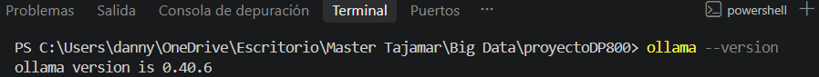

### Descarga y prueba del modelo

Se descarga el modelo mediante:

    ollama pull embeddinggemma:300m

La primera prueba envía un texto al endpoint local
http://localhost:11434/api/embed y muestra la dimensión del vector
y sus cinco primeros valores.

La generación se realiza localmente, sin servicios de Azure.

### Resultado de la prueba

Se ha generado correctamente un embedding con el modelo local
embeddinggemma:300m mediante la API de Ollama.

El vector obtenido tiene 768 dimensiones. Se muestran sus cinco
primeros valores como comprobación.

La petición se ha realizado a localhost, sin utilizar servicios
de Azure. En esta prueba el vector permanece en PowerShell;
todavía no se ha almacenado en SQL Server.

Script: [06_test_embedding.ps1](scripts/06_test_embedding.ps1)

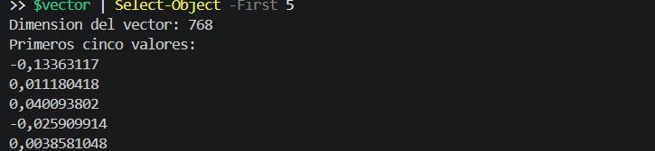

## Paso 7 — Preparación del almacenamiento vectorial

### Objetivo

Añadir a dbo.Productos una columna VECTOR(768) para almacenar
los embeddings generados con embeddinggemma:300m.

### Script

Archivo: [07_add_product_vector.sql](scripts/07_add_product_vector.sql)

### Diseño y comprobación

La columna permite NULL mientras el producto no tenga un embedding.
Su creación conserva los datos existentes.

Se comprueban el tipo, las dimensiones y el número de productos
con embedding y pendientes de generar.

### Resultado

Se ha añadido la columna Embedding de tipo VECTOR(768) a
dbo.Productos, conservando los datos existentes.

La consulta de metadatos confirma sus 768 dimensiones y que
permite valores NULL.

El recuento inicial devuelve:

| Total de productos | Con embedding | Pendientes |
|---|---|---|
| 30 | 0 | 30 |

La estructura queda preparada para almacenar los embeddings
que se generarán en el paso 8.

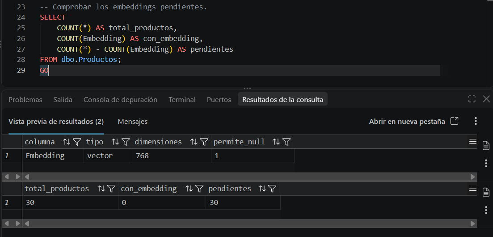

## Paso 8 — Generación y almacenamiento de embeddings

### Objetivo

Generar los embeddings de los 30 productos con Ollama y almacenarlos
en la columna Embedding de SQL Server.

### Script

Archivo: [08_generate_embeddings.ps1](scripts/08_generate_embeddings.ps1)

Ejecución desde la raíz del proyecto:

    .\scripts\08_generate_embeddings.ps1

### Funcionamiento

PowerShell lee los productos pendientes mediante autenticación
de Windows y envía a Ollama el nombre, la categoría y la descripción.

Se utiliza embeddinggemma:300m con el formato de documento:

    title: Nombre | text: Categoría. Descripción

Se comprueba que cada vector tenga 768 dimensiones y se guarda
mediante una actualización SQL parametrizada.

Precio y stock no se incluyen en el embedding: se utilizarán como
filtros SQL.

El proceso conserva los embeddings guardados y permite reanudar
la carga de los pendientes. No regenera automáticamente los vectores
si cambia la descripción de un producto.

### Incidencia — Ejecución de scripts PowerShell

PowerShell bloqueó inicialmente el archivo .ps1 porque la ejecución
de scripts estaba deshabilitada.

Se configuró RemoteSigned únicamente para la sesión actual:

    Set-ExecutionPolicy -Scope Process -ExecutionPolicy RemoteSigned

El ajuste desaparece al cerrar la terminal.

### Resultado

Se han generado y almacenado los embeddings de los 30 productos
mediante embeddinggemma:300m, ejecutado localmente con Ollama.

| Total de productos | Con embedding | Pendientes |
|---|---|---|
| 30 | 30 | 0 |

Cada embedding contiene 768 dimensiones y se almacena en la columna
Embedding de tipo VECTOR(768).

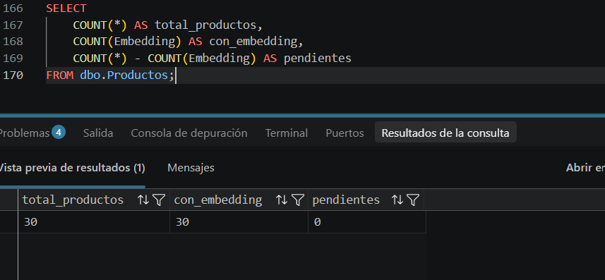

## Paso 9 — Primera búsqueda semántica

### Objetivo

Recuperar productos relacionados con una petición mediante embeddings,
combinando similitud semántica y filtros SQL de categoría, precio
y disponibilidad.

### Archivos

- [09_semantic_search.sql](scripts/09_semantic_search.sql)
- [10_search_products.ps1](scripts/10_search_products.ps1)

### Funcionamiento

1. PowerShell recibe la petición y los filtros.
2. Ollama genera el embedding de la petición con embeddinggemma:300m.
3. PowerShell envía el vector de 768 dimensiones y los filtros al
   procedimiento dbo.usp_BuscarProductosSemanticos.
4. SQL Server filtra los productos y calcula la distancia coseno
   entre sus embeddings y el de la petición.
5. Los resultados se muestran ordenados por distancia ascendente.

Para generar el embedding de la petición se utiliza el prefijo:

    task: search result | query: petición

Los productos y las peticiones utilizan el mismo modelo, con sus
respectivos formatos de documento y consulta.

La comparación se realiza mediante VECTOR_DISTANCE:

```sql
VECTOR_DISTANCE('cosine', p.Embedding, @Vector)
```

Una distancia menor indica mayor similitud. Esta cifra no representa
un porcentaje de acierto.

Se utiliza búsqueda exacta por el reducido tamaño del catálogo:
30 productos. No se necesita un índice vectorial para estas pruebas.

### Procedimiento almacenado

El procedimiento dbo.usp_BuscarProductosSemanticos recibe:

| Parámetro | Función | Valor predeterminado |
|---|---|---|
| @VectorJSON | Embedding de la petición en formato JSON | Obligatorio |
| @Categoria | Filtrar por categoría | NULL: todas |
| @PrecioMaximo | Establecer el precio máximo | NULL: sin límite |
| @SoloDisponibles | Devolver únicamente productos con stock | 1 |
| @Top | Número máximo de resultados | 5 |

El procedimiento convierte el JSON a VECTOR(768), aplica los filtros
y devuelve los productos ordenados por distancia y ProductoId,
utilizando este último para resolver empates.

Incluye validaciones para exigir un vector, limitar @Top al intervalo
de 1 a 30 y rechazar precios máximos negativos.

### Preparación de la ejecución

Con Ollama funcionando, comprobar su disponibilidad desde PowerShell:

```powershell
Invoke-RestMethod http://localhost:11434/api/tags
```

Si la sesión bloquea la ejecución de scripts, ejecutar:

```powershell
Set-ExecutionPolicy -Scope Process -ExecutionPolicy RemoteSigned
```

Este ajuste solo afecta a la sesión actual de PowerShell.

El archivo 10_search_products.ps1 se guarda como UTF-8 con BOM
para conservar las tildes al utilizar Windows PowerShell 5.1.

### Prueba 1 — Portátil para estudiar

Ejecutar desde la raíz del proyecto:

```powershell
.\scripts\10_search_products.ps1
```

Al no indicar parámetros, se utilizan los valores predeterminados:

| Entrada | Valor |
|---|---|
| Consulta | Un portatil ligero para estudiar |
| Categoría | Portátiles |
| Precio máximo | 800 € |
| Disponibilidad | Solo productos con stock |

Resultado obtenido:

| Posición | Producto | Distancia coseno |
|---|---|---|
| 1 | AulaBook 14 | 0,5348 |
| 2 | OfficeBook 15 | 0,5612 |

Ambos productos cumplen los filtros. AulaBook 14 ocupa la primera
posición porque presenta la menor distancia respecto a la petición.

### Prueba 2 — Teclado para escribir sin molestar

Ejecutar:

```powershell
.\scripts\10_search_products.ps1 -Consulta "Un teclado para escribir sin molestar" -Categoria "Teclados" -PrecioMaximo 100
```

Resultado obtenido:

| Posición | Producto | Precio | Stock | Distancia coseno |
|---|---|---|---|---|
| 1 | QuietKeys | 29,90 € | 25 | 0,4764 |
| 2 | ErgoSplit | 99,00 € | 6 | 0,5427 |
| 3 | PocketKeys | 44,90 € | 11 | 0,5600 |
| 4 | MechArena | 89,90 € | 14 | 0,6023 |

Todos los resultados pertenecen a la categoría Teclados, cuestan
como máximo 100 € y tienen stock disponible.

QuietKeys ocupa la primera posición por su mayor cercanía semántica
a la petición entre los productos que cumplen los filtros.

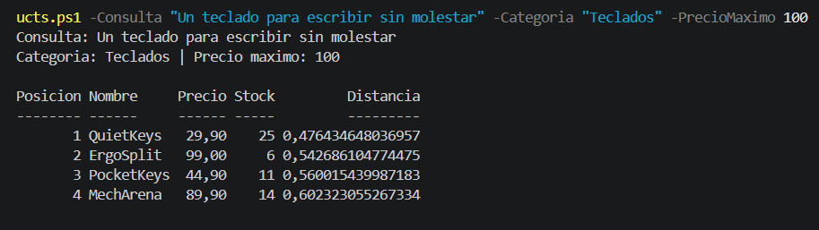

### Limitaciones

- La categoría y el presupuesto se proporcionan como parámetros
  explícitos; no se extraen automáticamente del texto.
- El procedimiento admite filtros opcionales, pero el script
  PowerShell utilizado en estas pruebas envía categoría y precio máximo.
- No se aplica un umbral de relevancia: se devuelven los productos
  más próximos entre los que cumplen los filtros, aunque su relación
  con la petición pueda ser débil.
- Estas dos pruebas constituyen una validación inicial. La calidad
  se complementa con los dos casos adicionales del paso 15.

### Resultado

Se ha validado el flujo completo de búsqueda semántica local:

    Petición → PowerShell → Ollama → Vector → SQL Server → Resultados

Ollama genera el embedding y SQL Server aplica los filtros y calcula
el ranking. El proceso funciona sin utilizar servicios de Azure.

Las dos pruebas sitúan en primera posición los productos esperados:
AulaBook 14 para estudiar y QuietKeys para escribir sin molestar.

## Paso 10 — Vista del catálogo

### Objetivo

Centralizar la consulta de productos y categorías en una vista
reutilizable, incorporando indicadores de disponibilidad y
existencia de embedding.

### Script

Archivo: [11_catalog_view.sql](scripts/11_catalog_view.sql)

### Diseño

La vista dbo.vw_CatalogoProductos une dbo.Productos y dbo.Categorias.

Incluye los datos del producto y dos indicadores de tipo BIT:

- Disponible: 1 si el stock es mayor que cero.
- TieneEmbedding: 1 si el producto tiene un embedding almacenado.

La columna vectorial no se muestra en la vista para facilitar
la lectura del catálogo.

La vista refleja los datos actuales de las tablas.
El orden se establece en la consulta que utiliza la vista.

### Resultado

Se ha creado y consultado correctamente la vista
dbo.vw_CatalogoProductos, que reúne los datos de productos
y categorías e incorpora los indicadores Disponible y TieneEmbedding.

La validación devuelve:

| Total de productos | Con embedding |
|---|---|
| 30 | 30 |

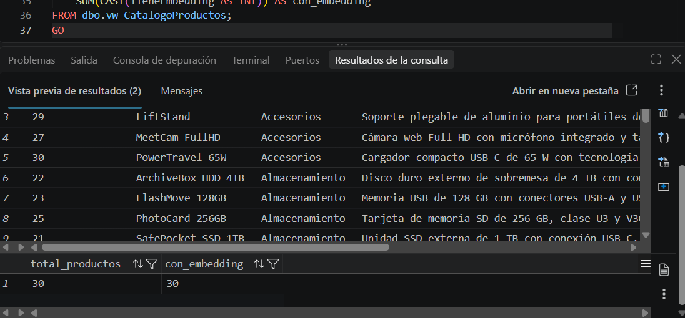

### Estado

Completado: vista creada, consultada y validada.

## Paso 11 — Búsqueda textual por palabras

### Objetivo

Implementar una búsqueda textual sencilla como referencia para
compararla con la búsqueda semántica, utilizando las mismas
peticiones y filtros.

### Script

Archivo: [12_keyword_search.sql](scripts/12_keyword_search.sql)

### Funcionamiento

El procedimiento dbo.usp_BuscarProductosPorPalabras:

1. Normaliza los signos de puntuación más habituales.
2. Divide la petición en palabras mediante STRING_SPLIT.
3. Descarta palabras de menos de tres caracteres y una lista
   básica de palabras frecuentes.
4. Elimina palabras duplicadas.
5. Busca cada palabra como fragmento del nombre o la descripción.
6. Aplica filtros de categoría, precio máximo y disponibilidad.
7. Ordena por número de palabras coincidentes descendente,
   utilizando ProductoId para resolver empates.

La comparación textual no distingue mayúsculas ni tildes.
Cada palabra distinta aporta como máximo un punto por producto.

Solo se devuelven productos con alguna coincidencia textual.

### Limitaciones

Es una búsqueda básica por fragmentos, sin sinónimos, análisis
lingüístico ni interpretación de negaciones.

La eliminación de palabras frecuentes puede perder información
de la intención, como ocurre con "sin molestar".

No equivale a una búsqueda de texto completo con ranking lingüístico.
La comparación permitirá observar las diferencias de este método
con la búsqueda mediante embeddings.

### Pruebas

Se ejecutan las mismas peticiones de las pruebas semánticas:

- Un portatil ligero para estudiar: Portátiles, hasta 800 €.
- Un teclado para escribir sin molestar: Teclados, hasta 100 €.

En ambos casos se exigen productos con stock disponible.

### Resultado

Se ha creado y ejecutado correctamente el procedimiento
dbo.usp_BuscarProductosPorPalabras.

Se han utilizado las mismas peticiones y filtros que en las
dos pruebas iniciales de búsqueda semántica.

En la búsqueda de portátiles, ambos métodos devuelven:
AulaBook 14 en primera posición y OfficeBook 15 en segunda.

En la búsqueda de teclados se obtiene:

| Posición | Por palabras | Semántica |
|---|---|---|
| 1 | QuietKeys | QuietKeys |
| 2 | MechArena | ErgoSplit |
| 3 | ErgoSplit | PocketKeys |
| 4 | PocketKeys | MechArena |

Ambos métodos sitúan primero el producto esperado en estas pruebas.
El orden de los demás teclados varía según el método.

La búsqueda textual ordena por palabras coincidentes y resuelve
los empates por ProductoId. La semántica ordena por distancia coseno.

Estas pruebas no permiten concluir que un método sea superior.
La comparación se amplía con los dos casos adicionales del paso 15.

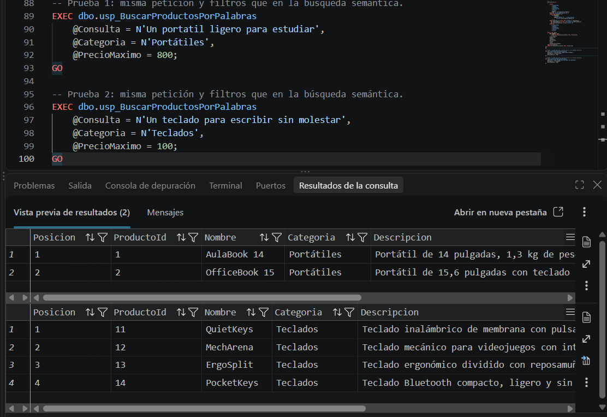

### Interpretación de las coincidencias

Los dos portátiles y los cuatro teclados obtienen una puntuación
de 1 en PalabrasCoincidentes.

Por tanto, la búsqueda textual no distingue su relevancia dentro
de cada prueba: todos empatan y se ordenan por ProductoId.

Que AulaBook 14 y QuietKeys aparezcan primero en la búsqueda
textual se debe al criterio de desempate, no a una puntuación
textual superior.

La búsqueda semántica obtiene distancias diferentes y sitúa
AulaBook 14 y QuietKeys primero por su cercanía vectorial
a las respectivas peticiones.

Esta diferencia muestra cómo se construye cada ranking,
pero todavía no demuestra una superioridad general del método
semántico. La comparación se amplía con dos casos adicionales en el paso 15.

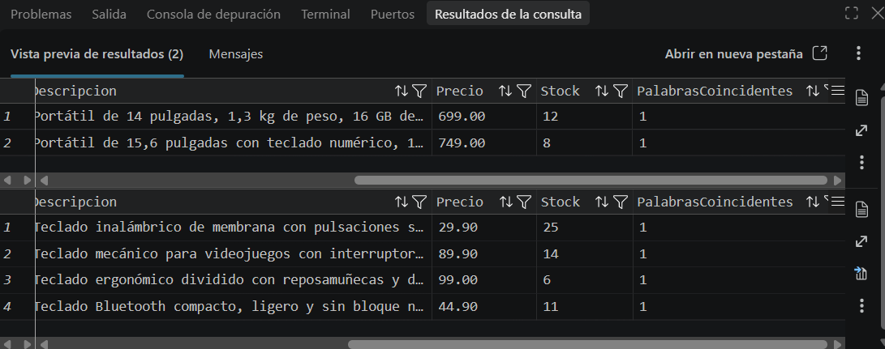

### Estado

Completado: procedimiento creado y dos búsquedas ejecutadas.

## Paso 12 — Consulta avanzada del catálogo

### Objetivo

Obtener los dos productos disponibles más baratos de cada categoría
y comparar su precio con la media de los productos disponibles
de esa categoría.

### Script

Archivo: [13_catalog_analysis.sql](scripts/13_catalog_analysis.sql)

### Funcionamiento

La consulta utiliza la vista dbo.vw_CatalogoProductos y dos CTE:

1. ProductosDisponibles selecciona los productos con stock.
2. AnalisisPorCategoria calcula la media de precio, el número
   de productos disponibles y la posición por precio en cada categoría.

Se utilizan funciones de ventana:

- AVG para calcular el precio medio por categoría.
- COUNT para contar los productos disponibles por categoría.
- ROW_NUMBER para ordenar los productos por precio ascendente,
  resolviendo los empates mediante ProductoId.

La consulta final conserva las dos primeras posiciones
de cada categoría.

La media y el recuento se calculan sobre todos los productos
disponibles de la categoría, antes de filtrar las posiciones.

### Interpretación

DiferenciaRespectoMedia muestra el precio del producto menos
el precio medio de su categoría:

- Valor negativo: precio inferior a la media.
- Cero: precio igual a la media.
- Valor positivo: precio superior a la media.

Esta consulta complementa la búsqueda semántica con un análisis
relacional de precios y disponibilidad.

### Resultado

Se ha ejecutado la consulta avanzada sobre la vista
dbo.vw_CatalogoProductos.

En las categorías visibles se comprueba que los productos
disponibles se numeran por precio ascendente y se conservan
las posiciones 1 y 2.

Por ejemplo, en Portátiles se obtienen:

| Posición | Producto | Precio | Media de categoría | Diferencia |
|---|---|---|---|---|
| 1 | AulaBook 14 | 699,00 € | 1.011,50 € | −312,50 € |
| 2 | OfficeBook 15 | 749,00 € | 1.011,50 € | −262,50 € |

La media corresponde a todos los productos disponibles de
la categoría, no únicamente a los dos seleccionados.

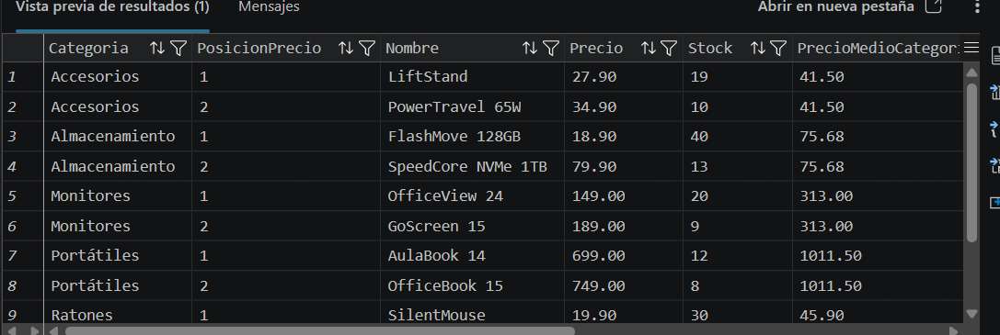

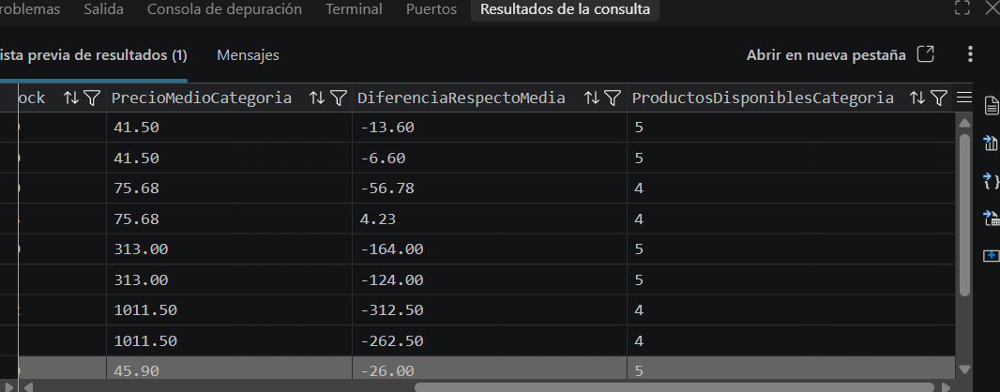

### Estado

Completado: consulta ejecutada y comprobadas las dos posiciones
por precio en las seis categorías del catálogo.

## Paso 13 — Índice relacional

### Objetivo

Crear un índice orientado a consultas que filtran productos
por categoría y precio.

### Script

Archivo: [14_catalog_index.sql](scripts/14_catalog_index.sql)

### Situación inicial

La tabla dbo.Productos dispone únicamente del índice clustered
PK_Productos sobre ProductoId.

### Diseño

Se crea el índice no agrupado IX_Productos_Categoria_Precio:

- Clave: CategoriaId, Precio.
- Columnas incluidas: Nombre, Stock.

El orden de las claves responde al filtro por categoría seguido
del rango de precio.

No se incluye el embedding en este índice. La búsqueda semántica
continúa utilizando comparación vectorial exacta.

### Validación prevista

Comprobar la creación del índice mediante los metadatos y revisar
el plan de una consulta por categoría, precio y disponibilidad.

Con 30 productos, la creación del índice no demuestra por sí sola
una mejora de rendimiento ni garantiza que el optimizador lo utilice.

### Resultado

Se ha creado el índice no agrupado
IX_Productos_Categoria_Precio sobre dbo.Productos:

- Claves: CategoriaId y Precio.
- Columnas incluidas: Nombre y Stock.

La consulta de prueba devuelve AulaBook 14 y OfficeBook 15,
ambos disponibles y con precio inferior o igual a 800 €.

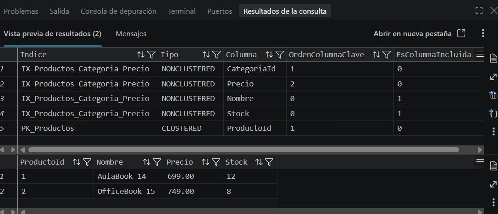

### Plan de ejecución

Se ha obtenido el plan mediante SET STATISTICS XML ON.

El plan utiliza:

1. Una búsqueda de índice sobre UQ_Categorias_Nombre
   para localizar la categoría Portátiles.
2. Una búsqueda de índice sobre IX_Productos_Categoria_Precio
   para acceder a los productos.
3. Una combinación mediante bucles anidados.

La consulta devuelve dos filas y el plan mostrado no incluye
una búsqueda adicional a la tabla de productos (Key Lookup).

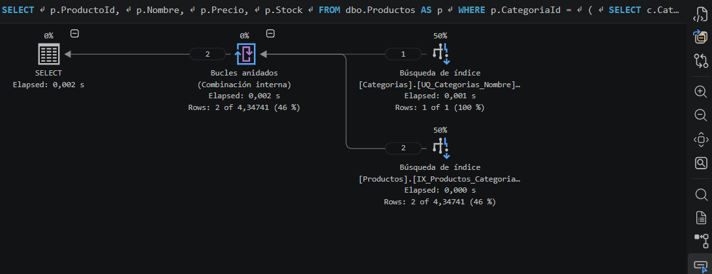

### Interpretación y alcance

Se confirma que el optimizador utiliza el índice creado
en esta consulta concreta.

No se ha realizado una comparación de rendimiento antes y después,
por lo que no se cuantifica una mejora.

Los porcentajes del plan representan costes estimados relativos
entre operadores, no porcentajes de aceleración.

### Estado

Completado: índice creado y uso comprobado en el plan de ejecución.

## Paso 14 — Seguridad por roles

### Objetivo

Separar las operaciones de consulta del catálogo y gestión
del stock mediante roles con permisos específicos.

### Script

Archivo: [15_catalog_security.sql](scripts/15_catalog_security.sql)

### Perfiles

| Rol | Permisos concedidos |
|---|---|
| rol_ConsultaCatalogo | SELECT sobre la vista y EXECUTE sobre los dos procedimientos de búsqueda |
| rol_GestionStock | SELECT sobre la vista y UPDATE únicamente sobre Stock en dbo.Productos |

Los permisos se conceden a los roles y los usuarios se incorporan
al rol correspondiente.

### Usuarios de prueba

Se crean usuario_Consulta y usuario_Stock mediante WITHOUT LOGIN.

Estos usuarios permiten probar los permisos con EXECUTE AS USER.
No disponen de un login para establecer conexiones independientes.

### Alcance

No se conceden permisos generales de lectura o escritura
sobre todas las tablas.

Las pruebas de acceso comprueban operaciones permitidas
y operaciones rechazadas para cada usuario.
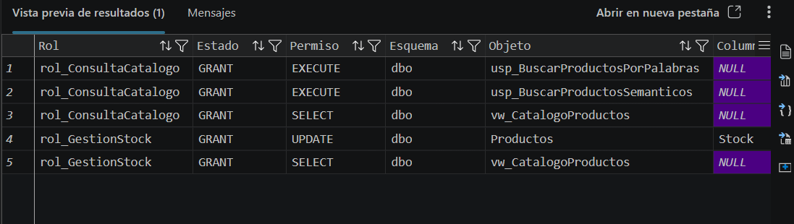

### Script de pruebas

Archivo: [16_test_security.sql](scripts/16_test_security.sql)

### Resultados de las pruebas

Se han comprobado los permisos mediante EXECUTE AS USER.

| Usuario | Operación | Resultado |
|---|---|---|
| usuario_Consulta | Consultar la vista | Permitida |
| usuario_Consulta | Ejecutar la búsqueda textual | Permitida |
| usuario_Consulta | Leer directamente dbo.Productos | Rechazada: error 229 |
| usuario_Consulta | Actualizar Stock | Rechazada: error 229 |
| usuario_Stock | Consultar la vista | Permitida |
| usuario_Stock | Actualizar Stock | Permitida |
| usuario_Stock | Actualizar Precio | Rechazada: error 230 |

Las sentencias UPDATE incluyen WHERE 1 = 0. Se comprueba
la autorización de las sentencias sin modificar ninguna fila.

Los errores esperados se capturan mediante TRY/CATCH.
Al finalizar, REVERT restaura el contexto original, dbo.

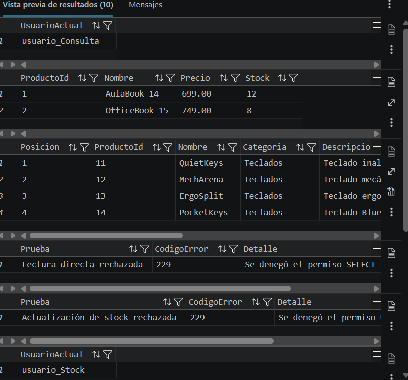

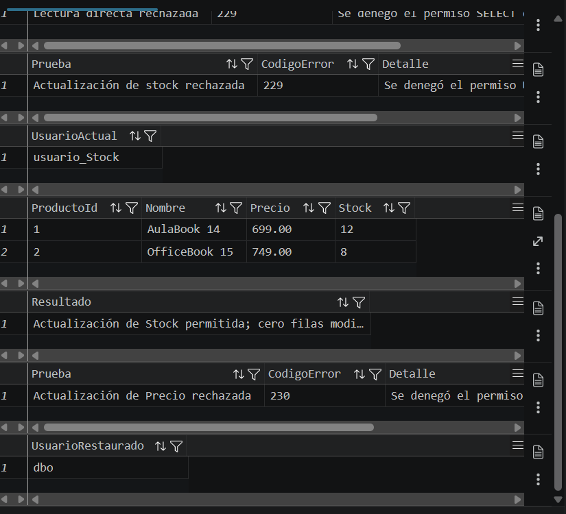

### Alcance de la validación

Se han validado las operaciones recogidas en la tabla anterior.
El permiso EXECUTE sobre el procedimiento semántico se ha
verificado en los metadatos, pero su ejecución bajo el usuario
de consulta no forma parte de estas pruebas.

### Estado

Completado: roles y permisos creados, y pruebas de acceso
ejecutadas con los resultados esperados.

## Paso 15 — Evaluación de las búsquedas

### Objetivo

Comparar la búsqueda textual por palabras y la búsqueda semántica
con las mismas peticiones, filtros y límite de cinco resultados.

### Scripts para repetir la evaluación

- [17_evaluation_keywords.sql](scripts/17_evaluation_keywords.sql): ejecutar
  desde el editor SQL para repetir los casos 3 y 4 por palabras.
- [18_evaluation_semantic.ps1](scripts/18_evaluation_semantic.ps1): ejecutar
  desde PowerShell con Ollama y SQL Server funcionando:

```powershell
.\scripts\18_evaluation_semantic.ps1
```

Estos dos archivos se han añadido durante la revisión final para conservar
las peticiones ya evaluadas. No cambian los criterios ni los resultados
registrados en las capturas. Su ejecución queda pendiente de comprobar
en el equipo del proyecto.

### Casos de prueba

Los casos 1 y 2 son las pruebas iniciales documentadas en los pasos 9 y 11.
Esta evaluación comprende únicamente los casos adicionales 3 y 4; se
conservan sus identificadores para mantener la correspondencia con las capturas.
Ambos exigen stock disponible.

| ID | Petición | Categoría | Precio máximo | Producto relevante |
|---|---|---|---|---|
| 3 | Un ordenador de menos de un kilo para trabajar muchas horas lejos de un enchufe | Portátiles | 1.200 € | TravelBook 13 (4) |
| 4 | Una pantalla para juegos rápidos con movimientos fluidos | Monitores | 350 € | SpeedView 27 (8) |


### Justificación de los productos relevantes

- Caso 3: TravelBook 13 pesa 990 gramos y ofrece autonomía
  de hasta catorce horas.
- Caso 4: SpeedView 27 ofrece 180 Hz y sincronización adaptativa.

### Criterios de evaluación

Para los casos 3 y 4 se registra:

- Acierto@1: 1 si el producto relevante aparece primero;
  0 en caso contrario.
- Acierto@3: 1 si aparece entre los tres primeros;
  0 en caso contrario.
- Posición del producto relevante, si aparece entre los cinco resultados.
- Cumplimiento de categoría, precio máximo y stock en todas
  las filas devueltas.

Si una búsqueda no devuelve filas, Acierto@1 y Acierto@3 valen 0
en los casos 3 y 4.
Las métricas agregadas utilizan un denominador de dos casos.


### Condiciones de comparación

- Mismo catálogo y mismos embeddings durante todas las pruebas.
- Misma petición y mismos filtros para ambos métodos.
- Máximo de cinco resultados y solo productos con stock.
- Productos relevantes fijados antes de ejecutar los casos nuevos.
- No se modifican las peticiones ni los criterios para favorecer
  los resultados de un método.

### Limitaciones

La evaluación utiliza un catálogo pequeño y sintético.
Se selecciona un producto objetivo por petición; otros productos
pueden ser parcialmente adecuados.

Los productos objetivo de los casos 3 y 4 se fijaron antes de ejecutar
sus búsquedas. Las dos pruebas iniciales se documentan por separado
y no se incorporan a las métricas finales.


### Resultado — Caso 3

Petición: «Un ordenador de menos de un kilo para trabajar muchas
horas lejos de un enchufe».

Filtros: Portátiles, precio máximo de 1.200 € y stock disponible.
Producto objetivo: TravelBook 13.

| Método | Posición del objetivo | Acierto@1 | Acierto@3 |
|---|---|---|---|
| Semántico | 1 | 1 | 1 |
| Por palabras | 1 | 1 | 1 |

Ambos métodos sitúan TravelBook 13 en primera posición.

En el ranking semántico, TravelBook 13 obtiene una distancia
de 0,51475 y OfficeBook 15 de 0,51493: la separación es pequeña.

El peso y la autonomía se expresan en el texto y no se aplican
como filtros estructurados. Por ello pueden aparecer otros productos
que no cumplan esas características, aunque sí cumplan los filtros SQL.

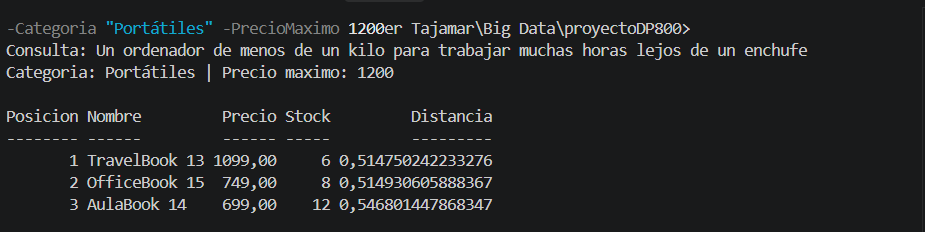

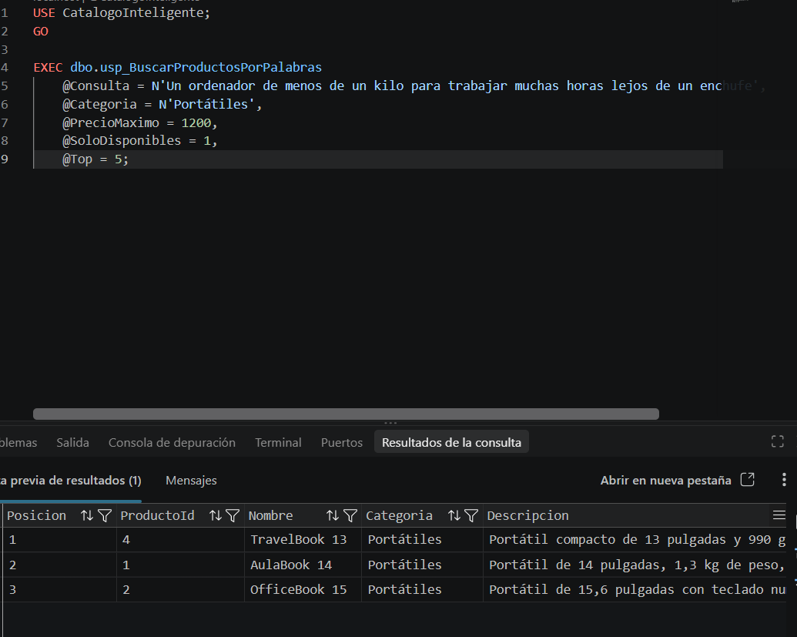
### Resultado — Caso 4

Petición: «Una pantalla para juegos rápidos con movimientos fluidos».

Filtros: Monitores, precio máximo de 350 € y stock disponible.
Producto objetivo: SpeedView 27.

| Método | Posición del objetivo | Acierto@1 | Acierto@3 |
|---|---|---|---|
| Semántico | 1 | 1 | 1 |
| Por palabras | 1 | 1 | 1 |

Ambos métodos sitúan SpeedView 27 en primera posición.

La búsqueda semántica devuelve SpeedView 27 (0,4560),
GoScreen 15 (0,6641) y OfficeView 24 (0,7001).
La búsqueda textual devuelve SpeedView 27 y GoScreen 15.

Devolver más productos no implica mayor calidad: en este caso,
ambos métodos recuperan primero el producto objetivo.

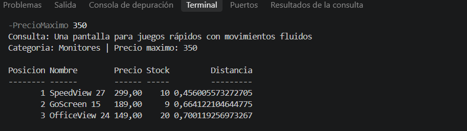

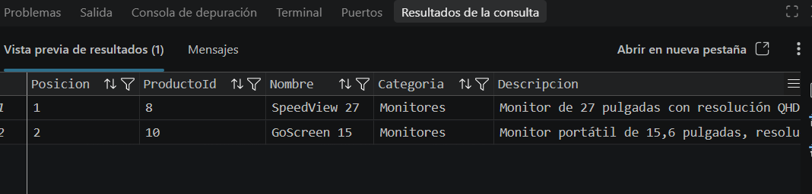

### Resumen de la evaluación

Se comparan dos casos utilizando las mismas peticiones y filtros
para la búsqueda textual y la semántica.

| Caso | Producto objetivo | Posición semántica | Posición textual |
|---|---|---|---|
| 3 — Portátil para desplazamientos | TravelBook 13 | 1 | 1 |
| 4 — Monitor para juegos rápidos | SpeedView 27 | 1 | 1 |

| Métrica | Semántica | Por palabras |
|---|---|---|
| Acierto@1 | 2/2 | 2/2 |
| Acierto@3 | 2/2 | 2/2 |

### Conclusiones

Ambos métodos sitúan el producto objetivo en primera posición
en los dos casos evaluados.

La búsqueda semántica ordena por distancia coseno y la textual
por número de palabras coincidentes, con desempate por ProductoId.

En el caso 3, la distancia semántica entre el primer y segundo
resultado es muy próxima. En el caso 4, la separación es mayor.

Estos resultados validan el funcionamiento de ambos métodos,
pero no demuestran que uno sea superior al otro.

### Limitaciones

La evaluación se limita a dos casos de un catálogo sintético
de 30 productos. No permite generalizar los resultados.

Las características expresadas en el texto, como peso y autonomía,
no se aplican como filtros estructurados. Los filtros explícitos
son categoría, precio máximo y disponibilidad.

### Estado

Completado: comparación de dos casos y documentación de resultados.

## Conclusión general

El catálogo modernizado combina datos relacionales y vectores en SQL Server
2025, con generación local de embeddings mediante Ollama. La migración,
la carga vectorial, las búsquedas, el índice y los permisos cuentan con
resultados documentados en los pasos anteriores.

En los dos casos adicionales, ambos métodos recuperan primero el producto
objetivo (Acierto@1 y Acierto@3 de 2/2). Esto valida esos casos de funcionamiento,
pero no demuestra superioridad general de la búsqueda semántica.

El índice relacional se utiliza en la consulta analizada. No se ha medido una
aceleración respecto a una ejecución anterior sin índice.

## Limitaciones y posibles mejoras

- Catálogo sintético de 30 productos y evaluación reducida a dos casos adicionales.
- Sin umbral de relevancia: la búsqueda semántica puede devolver candidatos poco relacionados.
- Precio, categoría y disponibilidad se pasan explícitamente; no se extraen del texto.
- Peso y autonomía no se validan mediante filtros estructurados.
- La búsqueda textual descarta términos de menos de tres caracteres, por lo que
  expresiones como `4K` o `SD` no participan en su puntuación.
- Si cambia el nombre, la categoría o la descripción de un producto, debe
  regenerarse su embedding. El script de carga solo procesa vectores nulos.
- Un cambio de modelo o configuración requiere regenerar los embeddings del
  catálogo y utilizar esa misma configuración para las peticiones.
- Los usuarios WITHOUT LOGIN demuestran autorización dentro de la base de datos;
  no prueban conexiones independientes de usuarios finales. Los scripts PowerShell
  siguen utilizando la identidad integrada de Windows que los ejecuta.
- La revisión final ha inspeccionado los scripts y los enlaces locales y ha
  comprobado la integridad de las imágenes y los recuentos del CSV. No se han
  reejecutado SQL Server ni Ollama en el entorno de revisión; las evidencias de
  ejecución corresponden a las capturas aportadas.

Como mejoras futuras se propone ampliar las pruebas, registrar el modelo y su
configuración, automatizar la actualización de embeddings y evaluar un umbral
de relevancia. Ninguna de estas mejoras se presenta como implementada.


